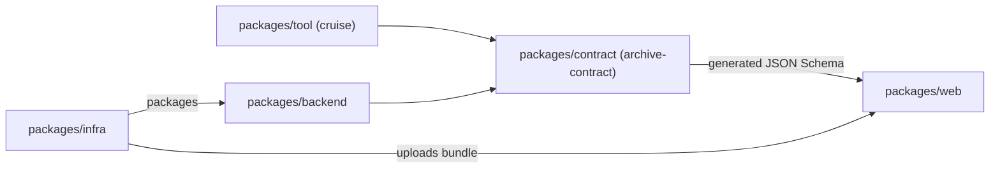

# Repo layout and conventions for research-in-a-box

## Goal

Every other plan can assume one repo layout, one toolchain and one set of names, and an empty skeleton of that repo exists with its checks passing locally and in CI. No features are designed here.

## One repo

Everything lives in one repo, `research-in-a-box`: the Python contract, the local tool, the backend Lambdas, the CDK construct with its default app, the web app, the agent layer, the docs and the CI. An adopter forks this one repo, edits one config file and deploys. The web app's JSON Schema, the backend and the local tool all use the contract from source, with no published artifact between them.

Python packages form a uv workspace; TypeScript packages form an npm workspace. Both are declared at the repo root.

Rests on: AGNT2, DCSN1

## Folder layout

```
research-in-a-box/
  packages/
    contract/      Python: archive-contract, the Pydantic models (Plan 2)
    tool/          Python: cruise, the local tool (Plan 3)
    backend/       Python: the Lambda code (Plans 6 and 7)
    infra/         TypeScript: the CDK construct and the default app (Plan 4)
    web/           TypeScript: the React and Vite web app (Plan 8)
  agent/           the plugin, MCP server and skills (Plan 9)
  examples/        example archive config and, from Plan 2, the sample package
  docs/            specs, plans and user docs
  .github/workflows/
  pyproject.toml   uv workspace root
  package.json     npm workspace root
  justfile
  LICENSE          MIT
```

Each Python package keeps its code under `src/<import name>/` and its tests under `tests/`. Where the MCP server sits inside `agent/` is Plan 9's call.



Rests on: AGNT2

## Names

| Thing | Name |
| --- | --- |
| The repo, and the docs title | `research-in-a-box` |
| The contract package and import | `archive-contract`, `archive_contract` |
| The CDK construct | `ResearchArchive` |
| The local tool: package, command and import | `cruise` |

`cruise` is never published, so the PyPI project of the same name doesn't matter. The only clash would be its `cruise` command if both were installed in one environment, and `uv tool install` gives each tool its own.

Rests on: DCSN1, DCSN2

## Installing cruise

`cruise` is installed from the repo with uv, at a release tag or the default branch:

```
uv tool install "git+https://github.com/<owner>/research-in-a-box@v0.1.0#subdirectory=packages/tool"
```

uv resolves `archive-contract` from the same checkout through the workspace source. Inside a clone, `uv run cruise` runs it. uv downloads a Python of its own, so a machine without Python needs only the uv installer. The docs name uv as the way to install; plain pip can't resolve the contract from the same repo. There is no standalone app.

Rests on: DCSN2, DCSN3, AGNT9

## Python tooling

- uv for dependencies, the lock file (`uv.lock`, committed) and the workspace.
- hatchling builds each package.
- ruff for lint and format.
- mypy in strict mode with the Pydantic plugin.
- pytest.
- `requires-python = ">=3.12"` for every package. The backend runs on the newest Lambda Python runtime that CDK offers, chosen in Plan 4.
- `archive-contract` is its own package; `cruise` and the backend depend on it through `[tool.uv.sources] archive-contract = { workspace = true }`.

Rests on: AGNT3, AGNT9

## TypeScript tooling

- npm workspaces, with `package-lock.json` committed.
- TypeScript in strict mode.
- ESLint with a flat config, and Prettier.
- Vitest for both the web app and the CDK construct tests.

Rests on: AGNT4

## One check command and CI

A root `justfile` holds the commands. `just check` runs every format check, lint, type check and test in both languages, plus the schema drift check. CI is GitHub Actions: on every push and pull request, `.github/workflows/ci.yml` runs `just check`, split into a Python job and a TypeScript job that each run their half (`just check-python`, `just check-ts`). The job commands are the same recipes a person runs, so local and CI can't disagree.

Deploy workflows with GitHub OIDC to AWS are Plan 10a's.

Rests on: AGNT1, AGNT5

## Schema drift

The JSON Schema generated from the contract is committed under `packages/web/`. `just check` regenerates it and fails when the committed copy differs. In the skeleton the contract is empty, so the generator and the check exist with an empty schema, and Plan 2 fills them in.

Rests on: AGNT6

## Versioning and releases

One SemVer version covers the whole repo, starting at 0.1.0. A `vX.Y.Z` tag runs `.github/workflows/release.yml`, which makes a GitHub release with generated notes. Nothing is published to PyPI or npm. People install `cruise` from a tag, and adopters deploy from their fork.

Rests on: AGNT7, DCSN2

## Risk and cost

Risk: low. The work creates a new, empty repo; a mistake is undone by editing or deleting files, and nothing outside the repo changes. Creating the GitHub repo is the one outward step, and it is a single step for you.

Cost: one step for you (creating the GitHub repo and pushing). The new programs are the ones named above (uv, just, Node and npm), which this machine already uses in other repos.

Rests on: AGNT1, DCSN1

## Left out

- Any feature design, and any code beyond empty packages and the checks.
- The sample package: Plan 2 builds it once the format exists. No data is committed by this plan.
- Publishing to PyPI or npm, and any standalone app.
- Deploy workflows, OIDC and the deployment skill (Plan 10a).
- Where the MCP server runs (Plan 9) and which Lambda runtime version (Plan 4).

Rests on: DCSN2, DCSN3

## How we'll know it works

- A fresh clone runs `just check` and it exits 0.
- The CI workflow on GitHub runs the same checks on the first push, and both jobs pass.
- `uv tool install` from the pushed repo installs a `cruise` command that runs (it prints its version).
- Each check fails when it should: a lint error, a type error, a failing test and a stale schema each make `just check` exit non-zero.
- Plan 2's folder has been told the layout and the contract's package name.

Rests on: AGNT5, AGNT6, DCSN2
