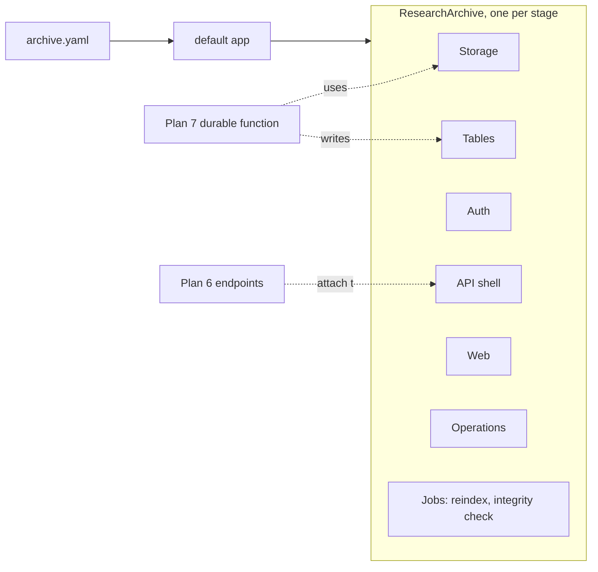

# Archive infrastructure: the ResearchArchive CDK construct

## Goal

Running `cdk deploy` on the default app stands up an empty, working research archive in the adopter's own AWS account: storage, the DynamoDB tables, sign-in, an API shell, web hosting with direct downloads for open data, operations defaults and the reindex path. It is one public `ResearchArchive` construct in `packages/infra`, built from internal parts and driven by the one archive config file, so a fork edits only that file. The construct exposes its tables, buckets, user pool and API so Plan 6's endpoints and Plan 7's durable function attach without editing Plan 4's code. The service choices under "Infrastructure" in the handoff are taken as settled.

## The parts

The construct is made of seven internal parts. Each is a plain construct in `packages/infra/src/`, and only `ResearchArchive` is exported.



| Part | What it creates |
| --- | --- |
| Storage | Staging, archive and derived buckets |
| Tables | Two catalog tables (A and B), five operational tables, the active-catalog parameter |
| Auth | Cognito user pool with email sign-in, groups, app clients |
| API shell | REST API, Cognito authorizer, throttling, one health route, optional regional WAF |
| Web | CloudFront distribution over the site, open data and the API |
| Operations | Budget alarm, alert topic, failure alarms, dashboard |
| Jobs | Reindex durable function, weekly integrity check |

Two optional modules, WAF and write-once locking, are switched on in the config; the construct builds each one only when its switch is on. Later plans add their own modules the same way.

Rests on: DCSN2, AGNT1

## Storage

- **Staging bucket.** Uploads land here before ingest (Plan 7). Not versioned; objects expire after 30 days.
- **Archive bucket.** Complete published packages, the source of truth. Versioning on. Two prefixes: `open/` for open data, served straight from CloudFront, and `restricted/` for restricted and by-request data, reached only through a short-lived link from the API. Objects are written with S3 SHA-256 checksums. Write-once locking (S3 Object Lock in governance mode, with a retention period from the config) is optional.
- **Derived bucket.** Everything rebuildable: `site/` (the web app bundle, the per-dataset HTML pages and the catalog file), `reindex/` (bulk put input and reports) and `logs/` (CloudFront standard logs).
- All buckets block public access, enforce TLS and use S3-managed encryption. CloudFront reads through origin access control.
- **Integrity check.** A weekly EventBridge Scheduler job runs a Lambda that compares each archived object's stored SHA-256 checksum with the package's `checksums.sha256` and sends an alert for any mismatch or missing object.

Rests on: AGNT7

## Tables

All tables are on-demand. Catalog records are rebuildable from S3; operational records exist nowhere else.

**Catalog tables (A and B).** One single-table design, created twice. Keys are `PK` and `SK`, plus one index `GSI1` (`GSI1PK`, `GSI1SK`).

| Item | PK | SK | GSI1 |
| --- | --- | --- | --- |
| Dataset (current state) | `DATASET#<id>` | `META` | `PROJECT#<project>` / `DATASET#<id>` |
| Dataset version | `DATASET#<id>` | `V#<version, zero-padded to 6>` | |
| File of a version | `DATASET#<id>` | `V#<version>#FILE#<path>` | |
| Project | `PROJECT#<id>` | `META` | |

The dataset item carries the current version, title, access level, theme and project. Plan 6 adds the vector index to both catalog tables, with the embedding model it chooses, and any further indexes its endpoints need; both catalog tables are on-demand, as a vector index requires.

**Operational tables.** One plain table per kind of record, each with point-in-time recovery.

| Table | Key | Index |
| --- | --- | --- |
| Submissions | `submissionId` | by `status` and `createdAt` (the curator queue); by `submitter` |
| Reviews | `submissionId`, `at#<eventId>` | |
| Settings | `name` | |
| UserProfiles | `userId` (Cognito sub) | |
| DownloadCounts | `datasetId`, `month` | |

Users and their roles live in Cognito; UserProfiles keeps only what Cognito can't hold (display name for citations, ORCID iD, notification settings). Plan 7 decides what goes in a review event, and Plan 6 what a setting holds; Plan 4 creates the tables and their keys.

Rests on: DCSN1, AGNT3, AGNT4, AGNT5, AGNT12

## Reindex

The catalog switch: an SSM parameter per stage, `/research-archive/<stage>/catalog-active`, names the active catalog table, `A` or `B`. Every Lambda reads it, cached for a minute.

The reindex is a Python durable function:

1. Empty the inactive catalog table.
2. In steps of a few hundred packages, read each published manifest from the archive bucket and write line-delimited DynamoDB JSON to `reindex/<run>/` in the derived bucket.
3. Start a bulk put items operation into the inactive table, with the report to `reindex/<run>/report/`.
4. Wait, polling the operation, until it ends. On `FAILED` or `CANCELLED`, stop and alert; the active table is untouched.
5. On `COMPLETED_WITH_ERRORS`, stop and alert with the report's location, leaving the active table in place.
6. Flip the parameter to the newly loaded table.

A reindex is run while publishing is quiet: a package published during the run would be missing from the new table until the next reindex (follow-up PARK5).

An admin starts it with `just reindex <stage>`, which invokes the function asynchronously with their AWS credentials and prints the execution ARN, and follows it with `just reindex-status <stage>`. The function name comes from a stack output.

Rests on: DCSN1, DCSN3, AGNT8, AGNT10

## Config and the construct's interface

The infrastructure settings join the one archive config as an `infrastructure` section of the Pydantic `ArchiveConfig`:

```yaml
infrastructure:
  stages:
    - name: prod            # account and region optional
  alertEmail: data@example.edu
  monthlyBudgetUsd: 50
  modules:
    waf: true                             # optional
    objectLock: { retentionDays: 3650 }   # optional
```

The contract's generated JSON Schema also generates the construct's TypeScript props type, `ArchiveConfig`, committed beside the web schema and covered by the same drift check in CI. `ResearchArchive` takes `{ config: ArchiveConfig, stage: string }` and plain props, so it can be used without a file. The default app reads `archive.yaml`, validates it against the schema, and makes one stack per stage.

The construct exposes, as read-only properties: `stagingBucket`, `archiveBucket`, `derivedBucket`, `catalogTables` with `activeCatalogParameter`, `submissions`, `reviews`, `settings`, `userProfiles`, `downloadCounts`, `userPool`, `api` with its authorizer, `distribution`, `alertTopic`, and one method, `pythonFunction(id, props)`, that builds a Python Lambda from `archive-backend` the same way Plan 4's own functions are built, with the alert alarm wired. Plans 6 and 7 attach through these.

Rests on: DCSN2, AGNT1

## Python Lambdas

Every Python function runs on arm64 with Python 3.13. A just recipe, `just lambda-assets`, uses uv to install `archive-backend` and its locked dependencies as manylinux aarch64 wheels, binary-only, into `packages/infra/assets/python/`, which `pythonFunction` packages. No Docker. The synth tests use the same recipe, so a dependency with no aarch64 wheel fails CI, not a deploy.

Rests on: AGNT2

## Auth

- A Cognito user pool with email sign-in and self-service sign-up. Groups: `contributor`, `curator`, `admin`. Roles reach the API in the token, so the authorizer needs no table read.
- Two app clients, both with authorization code and PKCE and no client secret: one for the web app, one for the CLI and MCP server, which sign in through the browser and hold short-lived tokens only.
- Cognito's managed login on a Cognito domain.
- Open data needs no account.

Rests on: AGNT5

## API shell and web

- **API.** A REST API with stage throttling (rate and burst from the config, with defaults), a Cognito authorizer, and one route, `GET /health`, backed by a Python function from `pythonFunction`. Optional regional WAF with AWS managed rule groups, attached to the API stage.
- **CloudFront.** One distribution. Default behaviour: the derived bucket's `site/` prefix, with unknown paths falling back to the app's `index.html`. `/data/*`: the archive bucket's `open/` prefix, at stable URLs. `/api/*`: the REST API, uncached, so the app calls the API on its own origin. Standard logs to the derived bucket's `logs/`.
- **Download logs.** CloudFront's standard logs are the only record of an open download, so they are on from the first deploy. Plan 6 rolls them up into DownloadCounts and counts restricted downloads when the API issues the link.

Rests on: AGNT6, AGNT11

## Operations and stages

- **Operations in every deploy.** An AWS Budgets monthly budget with an email alert at 80 and 100 percent; an SNS alert topic subscribed to the config's alert email; alarms on Lambda errors, durable execution failures, API 5xx and throttles, and the integrity check; a CloudWatch dashboard with the API, Lambdas, tables and CloudFront.
- **Stages.** One stage, `prod`, by default. Each entry in `stages` makes a stack, `ResearchArchive-<stage>`, with its own buckets, tables and user pool, optionally in its own account and region. The `prod` stage keeps its data on delete (retained buckets and tables, deletion protection); any other stage is set to be torn down cleanly. Every stack carries the `Repo` tag.

Rests on: DCSN4, AGNT9

## Risk and cost

- **Risk.** A mistake in a deployed `prod` stage could delete archived packages or the operational tables. Nothing is deployed yet and there are no users, so the construct is changed directly. Retained buckets and tables, deletion protection, bucket versioning and point-in-time recovery on the operational tables make a bad change recoverable. A reindex never touches the active catalog until its load has completed cleanly.
- **Cost.** One test deploy to an AWS account you choose, and its teardown, each a step for you on the page. No new programs on your machine: uv, npm, just and the AWS CLI are already used. The test deploy's running cost is a few dollars at most while it exists.

Rests on: DCSN4, AGNT10, AGNT12

## Left out

- API endpoints, the catalog file's contents and search (Plan 6).
- The ingest pipeline, review workflow, publish steps, by-request workflow and DOIs, including the DOI config setting (Plan 7).
- Rolling CloudFront logs up into download counts, and counting restricted downloads (Plan 6).
- A custom domain (follow-up PARK2); the archive runs on its CloudFront domain, which is a stable URL.
- The deployment skill and the CI deploy workflows with OIDC (Plan 10a).
- The vector index, the embeddings config setting and choosing the embedding model (Plan 6).
- ORCID and university sign-in (follow-ups PARK3 and PARK4): nobody has an ORCID client or SAML metadata to test with yet, and email sign-in covers every case we have.
- Reindex from `cruise` through an admin API route (follow-up PARK1, needs Plan 6).
- A second-region copy (not offered, per the handoff) and a one-click template (deferred).
- Composing the parts as separate exported constructs, for a later library release.

Rests on: DCSN3, AGNT1, AGNT3

## How we'll know it works

- `just check` passes, including vitest synth tests on the default app with the sample config: every resource in "The parts" is present; with both optional modules off, no WAF or Object Lock appears; with a second stage in the config, a second stack appears; the `prod` stage's buckets and tables are retained and a `dev` stage's are not.
- The schema drift check fails when the Python `ArchiveConfig` changes and the generated TypeScript type is not regenerated.
- On one test deploy in your AWS account: `GET /api/health` answers 200 through CloudFront and returns 429 when throttled; an email user signs up and signs in through managed login; a file put under `open/` downloads from `/data/...` on the CloudFront domain; `just reindex test` loads a two-dataset DynamoDB JSON file into the inactive catalog, `just reindex-status test` reports `COMPLETED`, and the active-catalog parameter has flipped; the integrity check run by hand reports no mismatch, then reports one after an object is overwritten.
- The test deploy is destroyed cleanly afterwards.

Rests on: DCSN1, DCSN2, DCSN3, DCSN4, AGNT8, AGNT10
