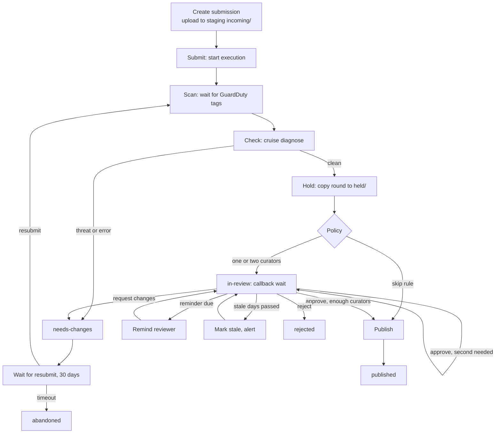

# Ingest and review: the first publish pipeline

## Goal

A contributor submits a package and the checks run. Under a review policy that an admin controls at run time, a curator then approves, rejects or requests changes. A request for changes loops back through the checks, and an approved package is published and findable. The pipeline is one Lambda durable function in Python. It builds on Plans 1 to 4 (the construct's buckets, tables and `pythonFunction`, `cruise.diagnose`, and the contract's models and exports) and rebuilds none of them. By-request access, takedown, access-level changes, DOIs, previews, extension checks and in-place metadata edits come later.

## The path

One submission is one durable execution, named by its submission id, from submit to its end. Every call that reads the clock, the network or a random value sits inside a named step, so a replay repeats none of them. Every callback wait has a timeout. The execution timeout is one year. A submission still open at one year ends as `expired`, and the event is recorded.

A submission's `status` is one of `draft` (created, files uploading), `checking`, `needs-changes`, `in-review`, `publishing`, `published`, `rejected`, `abandoned`, `expired` or `failed`. `stale: true` is a flag on `in-review`, not a status of its own. A step that fails after its retries ends the submission as `failed`, posts to the admin alert topic, and is recorded.

Rests on: DCSN1, AGNT4, AGNT5

## Submissions and upload

The Submissions table (Plan 4) holds one item per submission, keyed by `submissionId`. It holds `submitter` (the Cognito user id), `status`, `createdAt`, `round` (from 1), `files` (each round's paths, sizes and SHA-256 values), `datasetId` once known, `newVersion` (true when it versions a published dataset), `rule` (the policy rule that matched), `approvals`, `stale`, `callbackId` (the wait open now) and `reportKey`. The `byStatus` index is the curator queue, and `bySubmitter` is a contributor's own list.

A signed-in member of the `contributor` group creates a submission by listing its files with their sizes and SHA-256 values. The API returns one presigned PUT URL per file under the staging bucket's `incoming/<submissionId>/<round>/`. Each URL requires the declared SHA-256 checksum, so S3 refuses a file that doesn't match. A single PUT holds up to 5 GB.

If the manifest's `id` names a published dataset, the submission is that dataset's next version. Only the dataset's original submitter or a curator may submit it, and creating it is refused otherwise. With no `id`, the archive gives the dataset one at publish, made from the title and a short random suffix.

The staging lifecycle rule now expires only `incoming/` after 30 days. Once a round passes the checks, a step copies it to `held/<submissionId>/`, which never expires. Publish, reject, abandon and expire delete it. Plan 7 changes this rule in Plan 4's `storage.ts` and its synth test.

Rests on: AGNT1, AGNT2, AGNT3, AGNT6

## Scanning and checks

GuardDuty Malware Protection for S3 watches the staging bucket's `incoming/` prefix and tags every new object with `GuardDutyMalwareScanStatus`. The scan step waits with `wait_for_condition` until every file of the round carries the tag, backing off up to one hour. Any status other than `NO_THREATS_FOUND` (a threat, unsupported, access denied or failed) blocks the round with an error finding, `scan.<status>`, naming the file.

The check step then runs `cruise.diagnose` over the round with the archive config's profiles and required fields. That covers checksums, structure, every quality rule, the rights check (undetermined rights is a core-field error) and the completeness score. archive-backend gains a dependency on cruise, as the decision log says. The full diagnosis is written as JSON to the staging bucket's `reports/<submissionId>/<round>.json`, which never expires. The submission keeps its key. Any error-severity finding sends the round back as `needs-changes` and never reaches a curator. Warnings and notes go to review with the package.

The ingest Lambdas read the archive config from the SSM parameter `/research-archive/<stage>/archive-config`. The CDK app writes it at synth from the validated config, and synth fails if it is over 4 KB.

Rests on: DCSN3, AGNT14

## The review policy

The review policy is a `ReviewPolicy` model in `archive_contract`, so the web app gets it through the generated JSON Schema. It is stored as the Settings item `review-policy`. An admin reads and changes it with `GET` and `PUT /api/submissions/policy`. Plan 8 adds the admin screen. When a round enters review, its submission reads the policy once and records which rule matched, so a later edit never changes a submission already waiting.

The policy holds:

- `required`: whether review happens at all (default `true`).
- `rules`: an ordered list, where the first match wins. Each rule matches on any of: submitter (user ids, or the curator group), new dataset or new version, access level, and theme. Its outcome is `skip`, `one` or `two` curators. With no match, the outcome is `one` when `required` is true and `skip` when it is false.
- `reviewers`: a map from theme to curator user ids. A named reviewer is asked first, and any curator may still decide.
- `reminders`: the days after entering review on which to remind (default none).
- `staleDays`: when a waiting review is marked stale (default 14).

Two-curator outcomes need two approvals from two different curators, and the submitter can be at most one of them. Otherwise a curator may decide their own submission, and the event records that they did.

Rests on: DCSN1, AGNT7, AGNT12, AGNT13

## Review and the request-changes loop

The review wait is a `wait_for_callback`. Its submitter step stores the callback id on the submission. The timeout runs to the next due reminder, or to the stale mark if no reminder is left. When a reminder comes due, the function sends it and waits again. At `staleDays` it sets `stale`, alerts, and keeps waiting with the stale interval as its timeout.

A curator's decision goes to `POST /api/submissions/{id}/decision` with `approve`, `reject` or `request-changes` and an optional note. The API checks that the caller is in the `curator` group, writes the event, and completes the current callback with `SendDurableExecutionCallbackSuccess`. On the first approval of a two-curator case, the function records it and waits again for a different curator.

On `request-changes`, or on a round blocked by the checks, the submission goes to `needs-changes` with the note or findings. The function then waits on a resubmit callback with a 30-day timeout. The contributor gets the next round's upload URLs from `POST /api/submissions/{id}/uploads`, uploads, and calls `POST /api/submissions/{id}/submit`, which completes that callback. The function goes back to the scan step with the next round. If no resubmit arrives within 30 days, the submission ends as `abandoned`.

Rests on: DCSN1, AGNT4, AGNT5, AGNT7

## Notifications

A new SNS topic is for curators. Each curator subscribes by email and confirms once, through `just add-curator <stage> <email> <userId>`. Their subscription filter matches messages addressed to their user id, and messages addressed to all curators. A message goes out when a submission enters review, on each reminder, and on the stale mark. It is addressed to the named reviewer when the theme has one, and otherwise to all curators. Contributors read their submission's status from `GET /api/submissions/{id}`, and contributor email is a follow-up. The stale mark and failed steps also go to the existing admin alert topic.

Rests on: DCSN2

## Publish

Publish is a series of steps, each safe to repeat:

1. **Version.** A new dataset takes version 1. A new version takes the dataset item's `currentVersion` plus 1 from the active catalog table.
2. **Fill in.** Set the manifest's `id`, `version`, publisher (from the config), publication year, and identifier `https://<domain>/datasets/<id>/v<version>`. Then regenerate `README.md` with the contract's readme export and rewrite `checksums.sha256` to match.
3. **Copy.** Write every file to `open/<id>/<version>/` (access `open`) or `restricted/<id>/<version>/` (every other level) in the archive bucket. Each file goes in one PUT with its full-object SHA-256 checksum, so the weekly integrity check holds. The manifest goes last, so a reader never finds a manifest without its files.
4. **Catalog.** Put the version, file and dataset items into the active catalog table, named by its SSM parameter. They are built by the same `catalog_items` and `dataset_item` functions the reindex uses, so the two paths never differ. Catching up packages published during a reindex stays Plan 4's PARK5.
5. **Page.** Write `site/datasets/<id>/index.html` in the derived bucket. It holds the title, description, citation, current version, file links (for open data), and schema.org JSON-LD from the contract's export, and it reads on its own. The CloudFront site function now sends `/datasets/<id>` and `/datasets/<id>/` to that file, and every other extensionless path to `/index.html` as before. Plan 8 adds the web app's takeover by rebuilding pages from the template.
6. **Catalog file.** Call Plan 6's catalog-file writer in archive-backend. If that writer isn't built when this plan builds, this step is added when it lands. That is build order: the catalog file is only ever written by Plan 6's function.
7. **Finish.** Delete `held/<submissionId>/`, set `published`, and record the event with the dataset id and version.

A package's `archive:project` is kept as it is. Project records live at `projects/<projectId>/project.json` in the archive bucket, and creating them is a follow-up.

Rests on: AGNT1, AGNT6, AGNT8, AGNT9, AGNT10, AGNT11

## The audit log

Every state change and every decision is one item in the Reviews table (Plan 4), keyed by `submissionId` and `eventKey` = `<ISO time>#<eventId>`. An item holds `type` (created, submitted, scanned, checked, held, entered-review, reminded, stale, decided, resubmitted, published, rejected, abandoned, expired, failed), `actor` (a user id or `pipeline`), the round, and the type's details: the rule that matched, the decision and note, a self-review flag, the finding counts, the dataset id and version. The pipeline writes its events inside the step that makes the change, and the API writes a decision's event before it sends the callback. `GET /api/submissions/{id}` returns the submission with its events.

Rests on: AGNT7, AGNT13

## The API and the infrastructure

The endpoints are under `/api/submissions`, behind the Cognito authorizer, with the role checked in the handler:

| Method and path | Who | Does |
| --- | --- | --- |
| `POST /api/submissions` | contributor | Create a submission and return round 1's upload URLs |
| `POST /api/submissions/{id}/uploads` | its submitter | The next round's upload URLs, while `needs-changes` |
| `POST /api/submissions/{id}/submit` | its submitter | Start the execution (round 1) or complete the resubmit callback |
| `GET /api/submissions` | contributor, curator | Your own submissions, or the queue by status for a curator |
| `GET /api/submissions/{id}` | its submitter, curator | Status, the latest findings report, events |
| `POST /api/submissions/{id}/decision` | curator | Approve, reject or request changes |
| `GET`, `PUT /api/submissions/policy` | admin | Read and set the review policy |

A new `Ingest` construct in `packages/infra/src/ingest.ts` builds, through `archive.pythonFunction`:

- The durable `IngestFunction`, with a `live` alias and a one-year execution timeout.
- The `SubmissionsFunction` behind the routes, which invokes the alias asynchronously with the submission id as the execution name, and may send callbacks to it.
- The curators' topic.
- The GuardDuty malware protection plan on the staging bucket's `incoming/` prefix, with its role.
- The archive-config parameter.

It also changes the staging lifecycle rule in `storage.ts` and the site function in `web.ts`, each with its synth test. The archive-config parameter is the one way any Lambda reads the config, so Plan 6 uses it too. It goes in the Decision log, with the site function's `/datasets/<id>` rule, for Plans 6 and 8. The Python code is `archive_backend.ingest` (the durable handler and its steps), `archive_backend.submissions` (the API) and `archive_backend.pages` (the dataset page).

Rests on: AGNT1, AGNT3, AGNT9, AGNT12, AGNT14, DCSN2, DCSN3

## Risk and cost

**Risk.** A mistake could publish what shouldn't be public: a package that skipped review it needed, or files that should have been restricted. Takedown isn't built yet (follow-up PARK2). Until it is, a bad publish is undone by hand: delete the version's objects and its catalog items, then run a reindex. A mistake could also lose a contributor's staged files, which they can upload again. Nothing already in the archive is overwritten, because every publish writes a new version path. The checks are sized to this risk: unit tests for the policy matcher, the state changes and each publish step, synth tests for the infrastructure changes, and one scripted run on a test stage.

**Cost.** Your steps: deploy a test stage, confirm your curator email subscription, and turn on GuardDuty Malware Protection, which charges per GB scanned. No new programs.

Rests on: DCSN3, AGNT3

## Left out

These are follow-ups or later plans in this folder:

- By-request access (PARK1).
- Takedown and access-level changes (PARK2).
- DOIs (PARK3).
- Previews and spatial extent (PARK4).
- Extension checks from the config (PARK5).
- In-place metadata edits (PARK6).
- Contributor email (PARK8).
- Multipart uploads over 5 GB (PARK9).
- Creating projects (PARK10).
- Withdrawing a submission (PARK11).

The submitting clients (CLI, MCP, web screens, the admin's policy screen) belong to Plans 8 and 9.

Rests on: AGNT1, AGNT8, DCSN2

## How we'll know it works

- Unit tests pass (`just check`, the repo's CI gate) for the policy matcher (every outcome, the first match winning, the defaults), the state machine driven through a fake durable context, as the reindex's tests do (approve, reject, request changes then approve, a blocking error, a threat finding, the stale mark and a reminder, abandoned), and each publish step against a stubbed AWS.
- A packaging test fails CI if the unzipped Lambda asset (now carrying cruise and DuckDB, and shared by every function) reaches Lambda's 250 MB limit.
- Synth tests show the ingest function's `live` alias, its routes, the GuardDuty plan scoped to `incoming/`, the lifecycle rule scoped to `incoming/`, and the site function's `/datasets/<id>` rewrite.
- On a deployed test stage, one scripted run submits the sample package through the four paths. Approve ends readable at `/data/<id>/1/` and at `/datasets/<id>`. Reject ends rejected. Request changes then approve ends at version 1 after round 2. A blocking error returns as `needs-changes`.
- The same run, under a set policy, shows a skip rule publishing without review, a two-curator case waiting for a second, different curator, and a named reviewer's reminder arriving at their email.
- The Reviews table holds one event per state change and decision in each run, including the rule that matched.

Rests on: DCSN1, DCSN2, DCSN3, AGNT13
